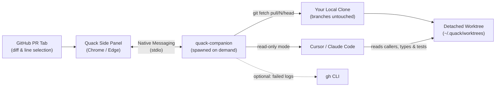

# Quack

Ask your local **Claude Code** or **Cursor** about any GitHub pull request with full repository context—without stashing local work or switching branches.

Quack pairs a Chrome/Edge side-panel extension with a lightweight local companion ([`quack-companion`](https://www.npmjs.com/package/quack-companion)). When you ask a question on a PR, the companion fetches the PR commit into a separate, detached git worktree and runs your local AI CLI there in read-only mode.



---

## Quick Install

### Prerequisites
- **macOS or Linux** with `Node.js >= 20`, `git >= 2.30`, and a **local clone** of the repo you're reviewing
- **Cursor CLI** (`agent` / `cursor-agent`) and/or **Claude Code** (`claude`), signed in locally
- *(Optional)* **GitHub CLI** (`gh`), signed in, to enable **Check CI** failure triage

### 1. Install the Extension
Install **[Quack from the Chrome Web Store](https://chromewebstore.google.com/detail/quack/hkdgklakkcffcmegdagdoigpaefhlipj)**.

### 2. Register the Local Companion
Run once in your terminal (registers Chrome, Edge, and Chromium):

```sh
npx quack-companion@latest install
```

*(No npm? Run `curl -fsSL https://github.com/oicramps/quack/releases/latest/download/install.sh | sh` instead.)*

Restart your browser once, open any PR on `github.com`, and click the **Quack** toolbar icon.

---

## Features

| Feature | How to Use It |
| --- | --- |
| **Ask with full repo context** | Open the side panel on any PR and ask a question—your agent can inspect callers, configs, and tests outside the diff. |
| **Attach exact diff lines** | Click a line number in a GitHub diff (Shift-click for a range), then press **`Cmd/Ctrl+Shift+K`** or click **Ask Quack**. |
| **Triage failing CI (`Check CI`)** | When checks fail and `gh` is logged in, click **Check CI** to separate real PR regressions (with copyable patches) from flaky jobs. |
| **Switch agents mid-thread** | Ask follow-ups in the same session, or switch between **Cursor** and **Claude Code** without losing earlier turns. |
| **Draft review comments** | Turn any answer into an editable Markdown review comment and jump straight to the GitHub diff line. |
| **Commit sync detection** | Quack tracks the exact commit SHA behind each answer and offers **Re-ask on latest** when new commits land. |

---

## Configuration & Cleanup

On first run, Quack creates `~/.quack/config.json` and scans common project folders (`~/Documents/Dev/Projects`, `~/Projects`, `~/Developer`, `~/repos`, `~/src`, `~/code`) up to 2 levels deep to match your local clone's `origin` remote. Add custom clone locations under `"repoPaths"`:

```json
{
  "scanRoots": ["~/Documents/Dev/Projects", "~/Projects", "~/Developer", "~/repos", "~/src", "~/code"],
  "repoPaths": { "owner/repo": "/custom/path/to/clone" },
  "worktreeRoot": "~/.quack/worktrees",
  "retentionDays": 7,
  "maxWorktrees": 20
}
```

Your working tree and local branches are **never modified**. To remove cached worktrees or uninstall the host at any time:

```sh
npx quack-companion doctor      # Check config and local AI agent status
npx quack-companion prune       # Remove all ~/.quack/worktrees and refs/pr-review/* refs
npx quack-companion uninstall   # Unregister browser manifests and remove ~/.quack/bin
```

---

## Local Development

Requires Node.js 22+ (the extension toolchain depends on it). The published companion still runs on Node.js 20+.

### Workspace Map

| Workspace | Path | Purpose |
| --- | --- | --- |
| `@quack/extension` | `extension/` | WXT + React 19 + TypeScript Manifest V3 extension |
| `quack-companion` | `companion/` | Node.js native messaging host, bundled with esbuild |
| `@quack/shared` | `shared/` | Wire protocol types, constants, and `quack-ci` parser |

### Commands (Yarn `1.22+`)

```sh
yarn install                                # Install workspace dependencies
yarn build                                  # Build companion + unpacked extension
yarn install-host                           # Register local companion from source
yarn dev                                    # Watch and rebuild extension on change
yarn workspace @quack/extension preview     # Open standalone UI preview server
yarn test                                   # Run companion unit tests
yarn typecheck                              # Type-check all workspaces
```

To load your local build in Chrome: open `chrome://extensions`, enable **Developer mode**, click **Load unpacked**, and select `extension/.output/chrome-mv3` (uses `DEV_EXTENSION_ID`).

## Further Reading

- **[Architecture](docs/architecture.md)** — Message protocol, worktree locking, agent adapters, and security boundaries.
- **[Release Guide & Privacy Policy](docs/release.md)** — CI/CD workflows, Trusted Publishing, Chrome Web Store reference, and privacy policy.
