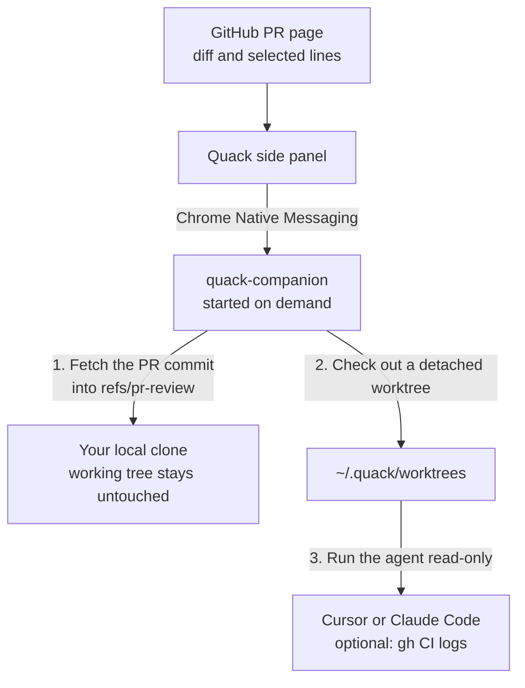

# quack-companion

Local native messaging host for **[Quack](https://chromewebstore.google.com/detail/quack/hkdgklakkcffcmegdagdoigpaefhlipj)** — the Chrome, Edge, and Brave extension that lets you ask your local **Claude Code** or **Cursor** about any GitHub pull request with full repository context, without stashing work or switching branches.

- **Install Extension**: [Quack on Chrome Web Store](https://chromewebstore.google.com/detail/quack/hkdgklakkcffcmegdagdoigpaefhlipj)
- **Source & Docs**: [github.com/oicramps/quack](https://github.com/oicramps/quack)

---

## Quick Start

1. Install the **[Quack extension](https://chromewebstore.google.com/detail/quack/hkdgklakkcffcmegdagdoigpaefhlipj)** in Chrome, Edge, or Brave. Brave installs that same Chrome Web Store listing.
2. Register the local companion once in your terminal:

```sh
npx quack-companion@latest install
```

*(Alternatives: `yarn dlx quack-companion@latest install`, or without a package manager via `curl -fsSL https://github.com/oicramps/quack/releases/latest/download/install.sh | sh`.)*

3. Restart your browser once, then open any pull request on `github.com`.

---

## How It Works

Browser extensions are sandboxed and cannot run `git` or local CLIs directly. The browser starts `quack-companion` automatically when you open the Quack side panel and stops it as soon as the panel closes—no background daemon or open terminal needed.



### What Does It Touch on Disk?

| Location | What Happens |
| --- | --- |
| **Your working tree & branches** | **Never modified.** Uncommitted edits, staged files, and active branches stay untouched. |
| `<your-clone>/.git/refs/pr-review/<n>` | Stores fetched PR commits outside `refs/heads/*`. |
| `~/.quack/worktrees/<owner>/<repo>/pr-<n>` | Isolated, detached git worktree where your AI agent reads the repo at the PR's exact commit. |
| `~/.quack/bin/` | Stores `quack-companion` pinned to your Node binary so Chrome can launch it reliably. |
| `~/.quack/config.json` | Local scan directories and worktree retention settings. |

---

## Requirements

| Requirement | Details |
| --- | --- |
| **OS** | macOS or Linux |
| **Runtime** | Node.js `>= 20` and `git >= 2.30` |
| **Local Clone** | A local git clone of the repository you are reviewing |
| **AI Agent** | [Cursor CLI](https://cursor.com) (`agent` / `cursor-agent`) and/or [Claude Code](https://docs.anthropic.com/en/docs/claude-code) (`claude`), signed in locally |
| **GitHub CLI** *(optional)* | [`gh`](https://cli.github.com/), signed in, to unlock **Check CI** (failed job log triage & flake detection) |

---

## CLI Commands

Run via `npx quack-companion` or directly via `~/.quack/bin/quack-companion`:

| Command | Description |
| --- | --- |
| `npx quack-companion@latest install` | Install or update the companion and register browser manifests |
| `npx quack-companion doctor` | Check config, scan roots, and local AI agent readiness |
| `npx quack-companion prune` | Delete all cached PR worktrees and `refs/pr-review/*` refs |
| `npx quack-companion uninstall` | Remove browser registrations and `~/.quack/bin` |
| `npx quack-companion --version` | Print installed version |

---

## Configuration

Created automatically on first run at `~/.quack/config.json`:

```json
{
  "scanRoots": [
    "~/Documents/Dev/Projects",
    "~/Projects",
    "~/Developer",
    "~/repos",
    "~/src",
    "~/code"
  ],
  "repoPaths": {
    "owner/repo": "/custom/path/to/clone"
  },
  "worktreeRoot": "~/.quack/worktrees",
  "retentionDays": 7,
  "maxWorktrees": 20
}
```

- **`scanRoots`**: Folders scanned (up to 2 levels deep) to match a local clone's `origin` remote URL to the open GitHub PR.
- **`repoPaths`**: Explicit paths for repositories cloned outside `scanRoots`.
- **Logs**: Timings and errors (never prompts or source code) are written to `~/.quack/logs/companion.log`.

## License

MIT
