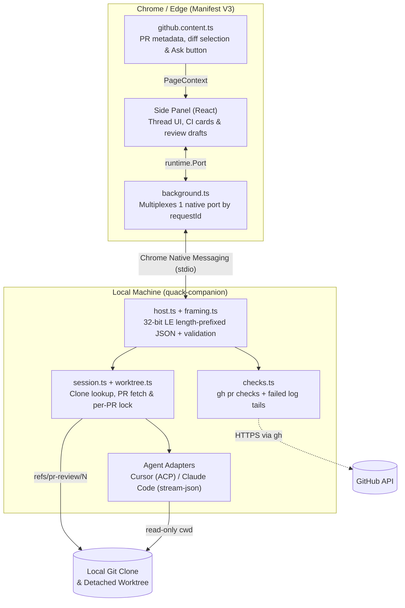
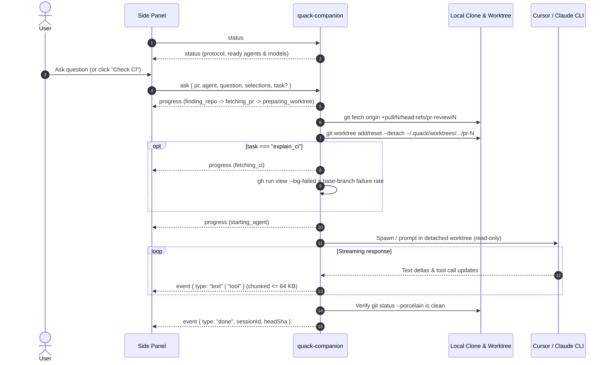

# Architecture

Quack is split into three TypeScript workspaces so the browser UI and local OS operations stay cleanly separated:

| Workspace | Path | Responsibility |
| --- | --- | --- |
| `@quack/shared` | `shared/` | Wire protocol types, shared constants, and the `quack-ci` JSON report parser |
| `@quack/extension` | `extension/` | Content script (`github.com`), background native-port multiplexer, and React side panel |
| `quack-companion` | `companion/` | Local Node.js native messaging host: clone lookup, git worktrees, `gh` CI logs, and AI CLI adapters |

---

## System Overview

---

## Request Lifecycle

---

## PR Resolution & Worktree Isolation

1. **Clone discovery (`companion/src/repo.ts`)**: Checks `config.repoPaths` overrides first, then scans `config.scanRoots` up to 2 directory levels deep, matching `git remote get-url origin` (SSH, HTTPS, or `git://`) against `owner/repo`.
2. **PR commit resolution (`companion/src/pr.ts`)**: Fetches `+pull/<n>/head:refs/pr-review/<n>`. Uses `gh pr view` when available for `baseRefOid`, `headRefOid`, title, and body; falls back to `git fetch` + `git merge-base` when `gh` is absent.
3. **Serialized worktrees (`companion/src/worktree.ts`)**: Checks out `~/.quack/worktrees/<owner>/<repo>/pr-<n>` detached at `headSha`. Concurrent requests for the same PR wait on an in-memory promise queue (`acquireLock`).
4. **Symlink-safe line reading (`companion/src/selection.ts`)**: Resolves GitHub's `#diff-<sha256(path)>` anchors against changed files in `baseSha...headSha` and reads snippets via `git show <sha>:<path>` rather than filesystem reads.

---

## Agent Adapters

| Adapter | CLI Invocation | Read-Only Enforcement | Follow-up Sessions |
| --- | --- | --- | --- |
| **Cursor** (`cursor.ts`, `acp.ts`) | `cursor-agent acp` (JSON-RPC 2.0 over stdio) | Session mode set to `ask`; `writeTextFile: false`, `terminal: false`; permission prompts auto-cancelled | Keeps `AcpClient` alive in memory for 15 min (`ACP_IDLE_MS`) |
| **Claude Code** (`claude.ts`, `stream.ts`) | `claude -p --output-format stream-json --verbose` | Runs with `--permission-mode plan` | Resumes via `--resume <sessionId>` |

After every turn, `session.ts` checks `git status --porcelain` in the worktree (`changedFiles`), warns if anything was touched, and `git reset --hard` + `git clean -fdq` runs before the next turn.

---

## Security Boundaries

| Boundary | Mechanism |
| --- | --- |
| **Origin allowlist** | `startHost` checks Chrome's `chrome-extension://<id>/` argument against `ALLOWED_EXTENSION_IDS` before reading `stdin`. |
| **No shell execution** | External tools (`git`, `gh`, `cursor-agent`, `claude`) run via `execFile` / `spawn` argument arrays (`exec.ts`), never a shell. |
| **Strict input validation** | `validate.ts` enforces length caps and regexes on all wire fields; model names, branches, session IDs, and workflow names reject leading `-` to block flag injection. |
| **Frame bounds** | Incoming frames cap at 64 MB; outgoing text deltas split at 64 KB (`MAX_TEXT_DELTA`) to stay under Chrome's 1 MB native messaging limit. |
| **Process tree cleanup** | Subprocesses run in their own process group (`detached: true`) and are killed via `SIGTERM` → `SIGKILL` (`killTree`) on cancel or browser disconnect. |
