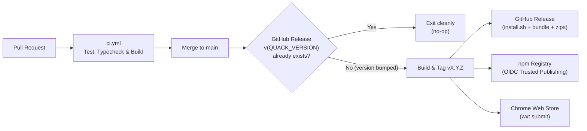

# Releasing Quack & Privacy Policy

Quack ships two artifacts synchronized to a single `QUACK_VERSION` in `shared/src/constants.ts`:

- **Browser extension (`@quack/extension`)**: Chrome Web Store (`hkdgklakkcffcmegdagdoigpaefhlipj`) and Edge Add-ons.
- **Local companion (`quack-companion`)**: npm registry (`npx quack-companion@latest install`) and GitHub Releases (`install.sh`, `quack-companion.cjs`, `.sha256`, `.tgz`).

> **Note on `PROTOCOL_VERSION`**: Bump `QUACK_VERSION` on every release. Bump `PROTOCOL_VERSION` **only** when a wire-protocol change breaks compatibility between the extension and an already-installed companion.

---

## Automated Release Pipeline



### Shipping a New Version (Day-to-Day)

1. On a branch, bump `QUACK_VERSION` in `shared/src/constants.ts` (e.g. `'0.2.1'`). *(Workspace `package.json` versions are synced automatically during the release workflow.)*
2. Open a PR into `main` and wait for `CI` (`ci.yml`) to pass.
3. **Merge the PR**. `release.yml` automatically tags `v0.2.1`, creates the GitHub Release, publishes `quack-companion@0.2.1` to npm, and submits the new extension `.zip` to the Chrome Web Store for review.

*(Avoid merging a second `QUACK_VERSION` bump while an earlier Chrome Web Store submission is still `Pending Review`, as the Web Store API blocks new uploads until the pending review finishes or is cancelled.)*

---

## One-Time Repository Setup

### 1. npm OIDC Trusted Publishing (No `NPM_TOKEN` Secret Needed)
Configured at `https://www.npmjs.com/package/quack-companion/access` under **Trusted Publisher (GitHub Actions)**:
- **Owner**: `oicramps` | **Repository**: `quack` | **Workflow**: `release.yml` | **Allow `npm publish`**: enabled.

### 2. GitHub Actions Secrets
Configured at `Settings -> Secrets and variables -> Actions`:

| Secret | Purpose |
| --- | --- |
| `CHROME_EXTENSION_ID` | Chrome Web Store item ID (`hkdgklakkcffcmegdagdoigpaefhlipj`) |
| `CHROME_CLIENT_ID` | Google Cloud OAuth 2.0 Web Application Client ID |
| `CHROME_CLIENT_SECRET` | Google Cloud OAuth 2.0 Client Secret |
| `CHROME_REFRESH_TOKEN` | Refresh token for scope `https://www.googleapis.com/auth/chromewebstore` |

*(Optional Edge Add-ons secrets: `EDGE_PRODUCT_ID`, `EDGE_CLIENT_ID`, `EDGE_API_KEY`.)*

### 3. Building Store Assets Locally

```sh
yarn workspace @quack/extension zip       # Builds keyless store zip in extension/.output/store/
yarn workspace @quack/extension preview   # Starts preview server for 1280x800 screenshots
yarn workspace @quack/extension icons     # Regenerates extension/public/icon/*.png
```

---

## Store Listing Reference

- **Single purpose**: *Quack lets you ask your own local AI agent about the code in a GitHub pull request you already have open, without checking that pull request out.*

| Permission | Justification |
| --- | --- |
| `nativeMessaging` | Communicates with the local companion process (`quack-companion`) that runs the user's installed AI CLI. |
| `sidePanel` | Displays the Quack UI in the browser's side panel next to the pull request. |
| `storage` | Stores selected agent/model preferences and recently queried pull requests locally in `chrome.storage.local`. |
| `https://github.com/*` | Reads PR metadata and selected diff lines from the active GitHub tab and renders the in-page Ask Quack button. |

---

## Privacy Policy

Quack consists of a browser extension and an open-source local companion program (`quack-companion`) that run on your computer.

- **Data read by the extension**: Quack activates only on `github.com` pull request pages. It reads the open pull request's repository owner and name, pull request number, title, commit SHA, and any diff lines you select. It stores your chosen AI agent, model preference, and recently queried pull requests locally on your device (`chrome.storage.local`).
- **Local processing**: The companion runs locally on your machine using your local git clone and, when inspecting failing checks, your authenticated GitHub CLI (`gh`). It invokes the local AI CLI you selected (Cursor or Claude Code) with your question and relevant repository context. Subsequent handling of that data is governed by the AI tool and account you configured.
- **No servers or telemetry**: Quack operates no backend servers, requires no Quack account, collects no analytics or usage telemetry, and does not sell, transmit, or share user data.
- **Data removal**: Uninstalling the browser extension deletes all locally stored preferences. Running `npx quack-companion uninstall` removes the native messaging registration and `~/.quack/bin`, and running `npx quack-companion prune` removes local PR review worktrees under `~/.quack/worktrees`.
