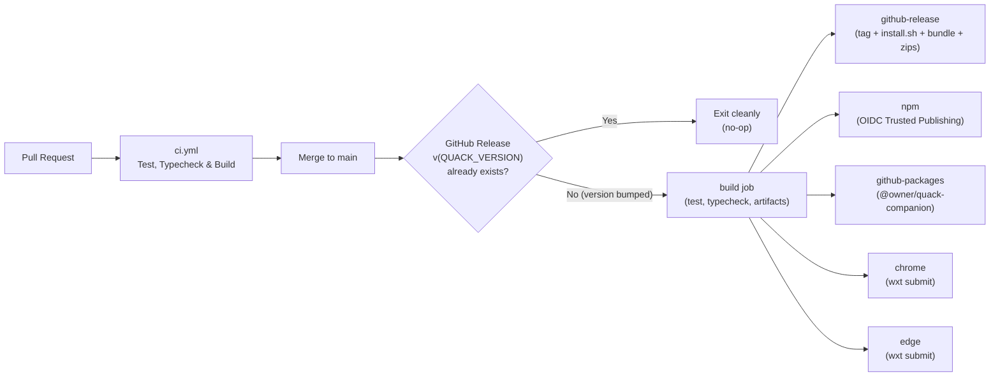

# Releasing Quacksteps & Privacy Policy

Quacksteps ships two artifacts synchronized to a single `QUACK_VERSION` in `shared/src/constants.ts`:

- **Browser extension (`@quacksteps/extension`)**: Chrome Web Store (`hkdgklakkcffcmegdagdoigpaefhlipj`), Edge Add-ons, and Firefox Add-ons (AMO, id `quacksteps@oicramps`).
- **Local companion (`quack-companion`)**: npm registry (`npx quack-companion@latest install`), the repository's GitHub Packages page (`@oicramps/quack-companion`), and GitHub Releases (`install.sh`, `quack-companion.cjs`, `.sha256`, `.tgz`).

> **Note on `PROTOCOL_VERSION`**: Bump `QUACK_VERSION` on every release. Bump `PROTOCOL_VERSION` **only** when a wire-protocol change breaks compatibility between the extension and an already-installed companion.

---

## Automated Release Pipeline



Each target is its own job, so one failing target doesn't stop the others. Every job skips work that is already done (existing tag, published version, pending store review), so retrying never needs a version bump.

### Retrying a Failed Release

- **Same run**: open the run in Actions and choose **Re-run failed jobs**. Only the failed targets run again, using the same build.
- **New run**: Actions → **Release** → **Run workflow** on `main`. This always releases the current `QUACK_VERSION`, and targets that already have it skip themselves.

A push to `main` alone won't retry, because the GitHub Release for that version already exists.

### Shipping a New Version (Day-to-Day)

1. On a branch, bump `QUACK_VERSION` in `shared/src/constants.ts` (e.g. `'0.2.1'`). *(Workspace `package.json` versions are synced automatically during the release workflow.)*
2. Open a PR into `main` and wait for `CI` (`ci.yml`) to pass.
3. **Merge the PR**. `release.yml` automatically tags `v0.2.1`, creates the GitHub Release, publishes `quack-companion@0.2.1` to npm, publishes `@oicramps/quack-companion@0.2.1` to GitHub Packages (so it shows on the repository Packages tab), and submits the new extension `.zip` to the Chrome Web Store for review.

*(Avoid merging a second `QUACK_VERSION` bump while an earlier Chrome Web Store submission is still `Pending Review`, as the Web Store API blocks new uploads until the pending review finishes or is cancelled.)*

---

## One-Time Repository Setup

### 1. npm OIDC Trusted Publishing (No `NPM_TOKEN` Secret Needed)
Configured at `https://www.npmjs.com/package/quack-companion/access` under **Trusted Publisher (GitHub Actions)**:
- **Owner**: `oicramps` | **Repository**: `quacksteps` | **Workflow**: `release.yml` | **Environment**: empty | **Allow `npm publish`**: enabled.

The `npm` job fails with `404 Not Found - PUT https://registry.npmjs.org/quack-companion` when any of these fields don't match the run exactly; npm then publishes anonymously. Its verbose log shows the OIDC exchange and why it was refused.

### 2. GitHub Actions Secrets
Configured at `Settings -> Secrets and variables -> Actions`:

| Secret | Purpose |
| --- | --- |
| `CHROME_EXTENSION_ID` | Chrome Web Store item ID (`hkdgklakkcffcmegdagdoigpaefhlipj`) |
| `CHROME_CLIENT_ID` | Google Cloud OAuth 2.0 Web Application Client ID |
| `CHROME_CLIENT_SECRET` | Google Cloud OAuth 2.0 Client Secret |
| `CHROME_REFRESH_TOKEN` | Refresh token for scope `https://www.googleapis.com/auth/chromewebstore` |

*(Optional Edge Add-ons secrets: `EDGE_PRODUCT_ID`, `EDGE_CLIENT_ID`, `EDGE_API_KEY`.)*

*(Optional Firefox Add-ons secrets: `FIREFOX_JWT_ISSUER` and `FIREFOX_JWT_SECRET`, the API key and secret from https://addons.mozilla.org/developers/addon/api/key/. Without them the `firefox` job skips.)*

#### Firefox Add-ons (AMO)
- The add-on id is `quacksteps@oicramps` (`FIREFOX_EXTENSION_ID` in `shared/src/constants.ts`). It can never change once the add-on is on AMO.
- **First upload is manual**: the API only adds versions to an existing add-on. Upload `quackstepsextension-<version>-firefox.zip` and `quackstepsextension-<version>-sources.zip` from the GitHub Release at https://addons.mozilla.org/developers/addon/submit/, and point reviewers to `docs/amo-review.md` for build steps.
- After that, each release's `firefox` job submits the new version and its sources zip. AMO reviewers rebuild from the sources zip, which holds the root workspace files, `shared/` and `extension/` (see `zip` in `extension/wxt.config.ts`).

### 3. Building Store Assets Locally

```sh
yarn workspace @quacksteps/extension zip       # Builds keyless store zip in extension/dist/store/
yarn workspace @quacksteps/extension preview   # Starts preview server for 1280x800 screenshots
yarn workspace @quacksteps/extension icons     # Regenerates extension/public/icon/*.png
```

---

## Store Listing Reference

- **Single purpose**: *Quacksteps lets you ask your own local AI agent about the code in a GitHub pull request you already have open, without checking that pull request out.*

| Permission | Justification |
| --- | --- |
| `nativeMessaging` | Communicates with the local companion process (`quack-companion`) that runs the user's installed AI CLI. |
| `sidePanel` | Displays the Quacksteps UI in the browser's side panel next to the pull request. |
| `storage` | Stores selected agent/model preferences and recently queried pull requests locally in `chrome.storage.local`. |
| `https://github.com/*` | Reads PR metadata and selected diff lines from the active GitHub tab and renders the in-page Ask Quacksteps button. |

---

## Privacy Policy

Quacksteps consists of a browser extension and an open-source local companion program (`quack-companion`) that run on your computer.

- **Data read by the extension**: Quacksteps activates only on `github.com` pull request pages. It reads the open pull request's repository owner and name, pull request number, title, commit SHA, and any diff lines you select. It stores your chosen AI agent, model preference, and recently queried pull requests locally on your device (`chrome.storage.local`).
- **Local processing**: The companion runs locally on your machine using your local git clone and, when inspecting failing checks, your authenticated GitHub CLI (`gh`). It invokes the local AI CLI you selected (Cursor or Claude Code) with your question and relevant repository context. Subsequent handling of that data is governed by the AI tool and account you configured.
- **Menu bar**: On macOS, while the side panel is open, a menu bar icon shows the repository, pull request number, and current step only, on the local machine.
- **No servers or telemetry**: Quacksteps operates no backend servers, requires no Quacksteps account, collects no analytics or usage telemetry, and does not sell, transmit, or share user data.
- **Data removal**: Uninstalling the browser extension deletes all locally stored preferences. Running `npx quack-companion uninstall` removes the native messaging registration and `~/.quack/bin`. Running `npx quack-companion prune` (also applied when the companion starts) deletes `pr-<n>` review worktrees under `~/.quack/worktrees` that are older than `retentionDays` (default 7) and, if more than `maxWorktrees` (default 20) remain, the oldest past that cap.
